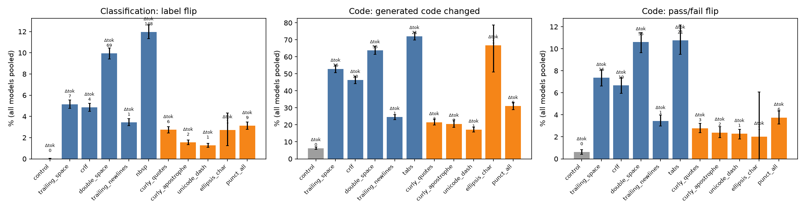
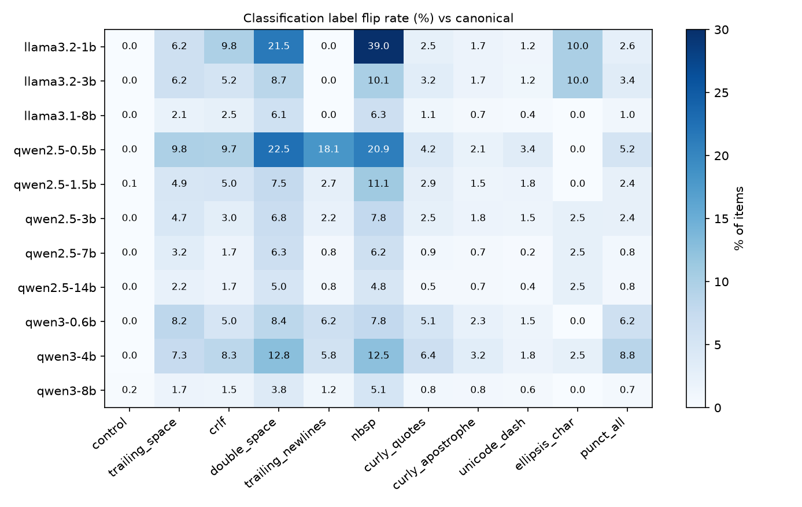
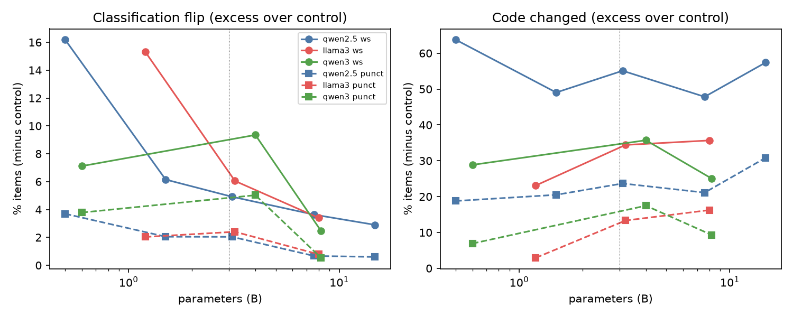

# Invisible Formatting Effects: How Whitespace and Punctuation Changes Alter Model Outputs

## 1. Executive Summary

**Question.** Do meaning-preserving formatting changes that a reader cannot see, or barely notices, change LLM outputs?
We tested trailing spaces, CRLF line endings, double spaces, no-break spaces, tabs, trailing newlines, curly quotes,
curly apostrophes, en/em dashes and the ellipsis character. We also asked how the effect differs between whitespace
and punctuation, small and large models, and classification and code generation.

**Answer.** Yes, and well above the noise floor. Across 11 open models (0.5B–14.8B parameters; Qwen2.5, Qwen3,
Llama-3.x) with greedy decoding, a single invisible formatting change flipped the label of **4.9% of classification
items** (95% CI 4.6–5.1%). Re-running the byte-identical prompt flipped 0.02%. The direction of the whitespace vs
punctuation effect is the **opposite of the hypothesis**: whitespace variants flipped **7.1%** of labels and punctuation
variants **2.2%**. Whitespace was more disruptive in every model and on both task types. Part of the gap comes from
whitespace edits rewriting many more tokens (a double-space or NBSP edit retokenises every word), but whitespace remains
more disruptive at a matched number of changed tokens. Models under 3B parameters flipped **2.2×** as often as ≥3B
models on classification (CI 2.0–2.4), which matches the hypothesised 2–3×. On code there was no size effect (pass/fail
flips 1.0–1.1×). Code *text* changed for 36% of problems under a perturbation, but only 5.1% of problems changed
pass/fail status. That is about the same rate as classification label flips, so code is "most affected" only if raw
text changes count.

**Practical implications.** (1) Normalise whitespace (line endings, NBSP, repeated spaces) before sending text to a
model. It matters more than normalising typographic punctuation. (2) A 2–5 percentage-point accuracy difference between
two prompt variants on a small model can come from formatting alone. Report results over several formattings, or
compare against an identical-prompt re-run. (3) Net accuracy barely moves (|Δ| < 1 pp per model): flips go in both
directions and land mostly on items the model gets wrong, so formatting adds variance rather than systematic bias.

## 2. Research Question & Motivation

**Hypothesis (as given).**
- H1: Formatting changes flip classification labels 5–15% of the time across models.
- H2: Whitespace variants (trailing spaces, line endings) cause 3–8% divergence; punctuation variants (quotes, dashes) cause 8–20%.
- H3: Models under 3B parameters are 2–3× more sensitive than larger ones.
- H4: Code generation is most affected (15–25% output change), because tokenizers treat whitespace differently in code.

**Why it matters.** Production text routinely arrives with CRLF endings from Windows, NBSPs from web pages and smart
quotes from word processors. If such invisible edits change outputs, benchmark numbers contain a hidden formatting term,
prompt A/B tests are confounded, and the same input behaves differently depending on which editor produced it.

**Gap.** The resource-finder stage was skipped for this workspace, so no papers, datasets or code were pre-gathered and
this assessment relies on background knowledge. Prompt-format sensitivity work (e.g. Sclar et al. 2023, *Quantifying
LMs' sensitivity to spurious features in prompt design*; Mizrahi et al. 2024, multi-prompt evaluation; Zhuo et al. 2024,
ProSA) mostly perturbs *visible* template structure: separators, casing, field names. Character-level robustness work
studies typos or adversarial edits. We did not find a controlled comparison of *invisible* whitespace vs punctuation
variants that (a) spans model sizes within families, (b) covers classification and code, (c) is measured against an
identical-prompt noise floor and (d) checks whether the edit survives the chat template and tokenizer.

## 3. Experimental Setup

### Models
All runs used greedy decoding (temperature 0) with vLLM 0.32.0 (bf16 / AWQ-INT4) on shared NVIDIA RTX A6000 GPUs.

| key | checkpoint | params | precision |
|---|---|---|---|
| qwen2.5-0.5b / 1.5b / 3b / 7b / 14b | Qwen/Qwen2.5-{0.5B,1.5B,3B,7B,14B}-Instruct-AWQ | 0.5–14.8B | AWQ-INT4 |
| llama3.2-1b | unsloth/Llama-3.2-1B-Instruct | 1.2B | bf16 |
| llama3.2-3b | AMead10/Llama-3.2-3B-Instruct-AWQ | 3.2B | AWQ |
| llama3.1-8b | hugging-quants/Meta-Llama-3.1-8B-Instruct-AWQ-INT4 | 8.0B | AWQ |
| qwen3-0.6b | Qwen/Qwen3-0.6B (thinking off) | 0.6B | bf16 |
| qwen3-4b | Qwen/Qwen3-4B-AWQ (thinking off) | 4.0B | AWQ |
| qwen3-8b | Qwen/Qwen3-8B via the host's vLLM server (OpenAI API, thinking off) | 8.2B | bf16 |

No commercial API key was available on this host, so all models are open-weight. API cost: $0.
Small = <3B (qwen2.5-0.5b, qwen2.5-1.5b, llama3.2-1b, qwen3-0.6b); large = ≥3B (the other 7).
Maximum new tokens: 12 for classification, 512 for code.

### Tasks and data
All data comes from local HF caches; samples were drawn with seed 42.

| task | source | n items | prompt |
|---|---|---|---|
| SST-2 sentiment | GLUE validation | 400 | `Classify the sentiment of the movie review below as "positive" or "negative".` / `Don't explain - answer with one word only.` / `Review: … Sentiment:` |
| AG News topic | test | 400 | 4 topics `"World", "Sports", "Business" or "Sci/Tech"`, same format |
| BoolQ | validation (passages ≤180 words) | 400 | `Read the passage and answer the question with "yes" or "no".` … |
| HumanEval | all | 164 | "Complete the following Python function. Don't change its signature - return the complete function … in a single \`\`\`python code block, without "explanations" or tests." + the prompt code |
| MBPP | full test split | 300 | task text + "Your code should pass these tests:" + the 3 asserts |

The instructions deliberately contain double quotes, an apostrophe and a spaced hyphen, so every punctuation variant
alters every prompt (except `ellipsis_char`; see below). Full templates are in `src/build_prompts.py`.

### Conditions (per item)
Each item was run under 12 conditions, giving 19,968 prompts per model and 239,616 generations including the replication.

| family | condition | edit |
|---|---|---|
| — | `canonical` | reference prompt |
| control | `control` | **byte-identical** to canonical, placed elsewhere in the batch (noise floor) |
| whitespace | `trailing_space` | a space at the end of every line |
| | `crlf` | `\n` → `\r\n` |
| | `double_space` | every single inter-word space → two spaces |
| | `trailing_newlines` | `\n\n` appended to the message |
| | `nbsp` (classification) | inter-word spaces → U+00A0 no-break space |
| | `tabs` (code) | 4-space indentation → tab (HumanEval only; MBPP prompts have no indentation) |
| punctuation | `curly_quotes` | `"x"` → `“x”` |
| | `curly_apostrophe` | `'` → `’` / `‘` (contractions such as `it 's` get `’`) |
| | `unicode_dash` | ` - ` → en dash, `--` → em dash, digit ranges → en dash |
| | `ellipsis_char` | `...` → `…` (only 40/1,200 classification and 9/464 code prompts contain `...`) |
| | `punct_all` | all four punctuation edits combined |

For code, the edits must leave the code valid. `double_space` and all punctuation edits are applied only to natural
language: the instruction, docstrings and comments, located with Python's `tokenize`. Doctest lines (`>>>` and their
expected output) are left untouched. Layout edits (`trailing_space`, `crlf`, `tabs`, `trailing_newlines`) apply to the
whole message. Perturbations that did not change the prompt string (e.g. `ellipsis_char` on text without `...`) are
excluded from all rates.

### Metrics
Each perturbed output is compared with the same model's canonical output for the same item.
- **Classification label flip:** the parsed label differs. The parser takes the earliest label keyword in the output;
  synonyms are mapped and anything else becomes `other`.
- **Code changed:** the extracted code (first fenced block with a `def`, CRLF and trailing whitespace normalised) differs.
- **Code pass/fail flip:** the unit-test outcome differs. Tests ran in a sandboxed subprocess (`python -I`, 2 GB limit,
  20 s timeout, results cached by program hash).
- **Token change and edit size:** each model's chat template and tokenizer were applied, and we recorded whether the
  token sequence changed and how many token positions differed (`difflib`).
- Accuracy against gold labels and unit tests.

### Statistics
Every metric is paired at item level, and 95% CIs come from a bootstrap over items (2,000 resamples). Perturbation vs
control per model × condition uses an exact McNemar (binomial) test on discordant items with Holm correction across all
110 tests. The small/large ratio uses a bootstrap with the same items resampled for all models. GEE logistic models
(binomial, exchangeable correlation clustered by item) estimate flip ~ punctuation + small + task, with and without the
log of the token edit size.

### Reproducibility controls
- **Replication:** Qwen2.5-0.5B was re-run in a separate engine and process on a different GPU. All 19,968 outputs were
  byte-identical to the first run, so every per-condition rate replicated exactly.
- **Noise floor:** the `control` condition captures vLLM's batch-position nondeterminism.
- **Placebo:** Llama-3.x chat templates strip trailing whitespace from messages, so `trailing_newlines` leaves their
  token sequence unchanged (verified with `tok_effect.py`).

Run time: about 3 hours of generation on shared GPUs (13:26–15:58), with 0.5–1.5B models taking 3–10 minutes and the
14B model about 1h40. Python 3.12, vLLM 0.32.0, torch 2.13, pandas, statsmodels.

## 4. Results

### 4.1 Overall rates vs the noise floor

| task kind | metric | control (identical prompt) | whitespace | punctuation | all perturbations |
|---|---|---|---|---|---|
| classification (1,200 items) | label flip | **0.02%** | **7.07%** | **2.17%** | **4.88%** [4.61, 5.14] |
| classification | raw output text changed | 0.13% | 11.7% | 5.2% | — |
| code (464 problems) | code text changed | 6.2% | 47.6% | 22.6% | 35.7% [34.2, 37.4] |
| code | pass/fail flip | 0.61% | 7.17% | 2.79% | 5.08% [4.69, 5.51] |

Averages are taken over items, models and conditions. The whitespace − punctuation difference has a tight CI for every
metric; for classification flips it is −4.9 pp [−5.2, −4.6]. Perturbation vs control was significant after Holm
correction in 80/110 model × condition cells for classification flips, 64/110 for code pass/fail and 89/110 for code
text. Most of the non-significant cells are `ellipsis_char`, which affects few items, or large-model punctuation cells.

*Figure 1. Divergence per perturbation, pooled over 11 models (bootstrap 95% CIs). Δtok is the mean number of prompt
token positions changed. Blue bars are whitespace edits, orange bars punctuation edits, grey is the identical-prompt control.*

### 4.2 Per perturbation

Rates are pooled over the 11 models.

| condition | Δtokens (cls) | cls flip | Δtokens (code) | code changed | code pass/fail flip |
|---|---|---|---|---|---|
| control | 0 | 0.02% | 0 | 6.2% | 0.6% |
| trailing_space | 7.4 | 5.1% | 16.3 | 52.9% | 7.4% |
| crlf | 4.3 | 4.9% | 10.1 | 46.3% | 6.7% |
| double_space | 68.9 | 9.9% | 54.5 | 63.7% | 10.6% |
| trailing_newlines | 0.7 | 3.4% | 1.5 | 24.5% | 3.5% |
| nbsp / tabs | 147.7 / 20.8 | 12.0% | — / 20.8 | 72.1% (tabs) | 10.8% (tabs) |
| curly_quotes | 6.1 | 2.7% | 3.2 | 21.5% | 2.8% |
| curly_apostrophe | 1.8 | 1.5% | 2.1 | 20.6% | 2.4% |
| unicode_dash | 1.3 | 1.3% | 1.1 | 17.1% | 2.3% |
| ellipsis_char* | 1.2 | 2.7% | 1.4 | 66.7% | 2.0% |
| punct_all | 9.2 | 3.1% | 6.3 | 31.0% | 3.7% |

\* `ellipsis_char` applies to only 40 classification and 9 code items per model, so its CIs are very wide.

### 4.3 Per model

*Figure 2. Classification label-flip rate (%) per model × condition. The Llama `trailing_newlines` column is exactly 0
because the chat template strips the newlines (placebo).*

| model | params | cls flip: ws | cls flip: punct | cls flip: all | code changed | code pass/fail flip | control code changed |
|---|---|---|---|---|---|---|---|
| qwen2.5-0.5b | 0.5 | 16.2% | 3.7% | 10.6% | 47.8% | 6.3% | 5.2% |
| qwen3-0.6b | 0.6 | 7.1% | 3.8% | 5.6% | 40.4% | 6.0% | 20.9% |
| llama3.2-1b | 1.2 | 15.3% | 2.0% | 9.4% | 29.3% | 3.7% | 15.1% |
| qwen2.5-1.5b | 1.5 | 6.2% | 2.1% | 4.4% | 38.9% | 6.4% | 3.2% |
| qwen2.5-3b | 3.1 | 4.9% | 2.0% | 3.6% | 45.1% | 7.6% | 4.3% |
| llama3.2-3b | 3.2 | 6.1% | 2.4% | 4.4% | 27.3% | 3.8% | 2.2% |
| qwen3-4b | 4.0 | 9.4% | 5.0% | 7.4% | 28.6% | 3.9% | 0.9% |
| qwen2.5-7b | 7.6 | 3.6% | 0.7% | 2.3% | 37.3% | 5.7% | 1.9% |
| llama3.1-8b | 8.0 | 3.4% | 0.8% | 2.2% | 29.5% | 4.3% | 2.4% |
| qwen3-8b | 8.2 | 2.6% | 0.7% | 1.8% | 26.5% | 2.9% | 8.0% |
| qwen2.5-14b | 14.8 | 2.9% | 0.6% | 1.9% | 49.1% | 6.0% | 7.1% |

Whitespace exceeds punctuation for every model on classification flips, code changes and code pass/fail flips.
Per-model CIs are in `results/tables/family_*_by_model.csv`. The one exception is Qwen3-8B's raw classification *text*
(not label): it changes as often under punctuation as under whitespace, mostly through capitalisation of the same label
(`positive` → `Positive`).

### 4.4 Model size

*Figure 3. Excess divergence over the control vs parameter count. Solid lines are whitespace, dashed lines punctuation.*

| metric | small (<3B, 4 models) | large (≥3B, 7 models) | ratio small/large [95% CI] |
|---|---|---|---|
| classification flip | 7.50% | 3.38% | **2.22 [2.03, 2.41]** |
| classification flip (Qwen2.5 only: 0.5/1.5B vs 3/7/14B) | 7.49% | 2.60% | 2.88 [2.55, 3.32] |
| code changed, excess over control | 27.4% | 30.8% | 0.89 [0.84, 0.94] |
| code pass/fail flip | 5.51% | 4.83% | 1.14 [0.96, 1.37] |

GEE models clustered by item agree:
- Classification flips: small OR = 2.39 (p < 1e-78); punctuation OR = 0.28 (p < 1e-190).
- Code pass/fail: small OR = 1.16 (p = 0.14, not significant); punctuation OR = 0.37.
- Code changed: small OR = 1.24.

### 4.5 Task type

| task | label / pass-fail flip | code changed |
|---|---|---|
| AG News | 8.5% | — |
| BoolQ | 3.1% | — |
| SST-2 | 3.0% | — |
| HumanEval | 6.7% | 50.3% |
| MBPP | 4.2% | 27.7% |

Rates are averaged over perturbations and models. Flip rates track task ambiguity: 4-way AG News, which has many
borderline Business/Sci-Tech/World items, flips most.

### 4.6 Mediators: tokens, uncertainty and accuracy
- **Token survival.** When the chat template and tokenizer produced an identical token sequence, outputs were unchanged
  except for the batch noise floor: classification flips 0.02%, code pass/fail 0.6%. This is the Llama
  `trailing_newlines` case. When the tokens changed, flips rose to 5.0% (classification) and 5.3% (code pass/fail).
- **Edit size.** Divergence grows with the number of changed tokens: classification OR = 1.40 per unit of log(1+Δtok).
  Controlling for edit size cuts the punctuation effect from OR 0.28 to 0.45 for classification and from 0.30 to 0.73
  for code text, but it stays significant. At a matched edit size, whitespace is still worse: `trailing_newlines`
  (≈1 token) flips 3.4% while `unicode_dash` (≈1.3 tokens) flips 1.3%; `crlf` (4.3 tokens) flips 4.9% while
  `curly_quotes` (6.1 tokens) flips 2.7%.
- **Uncertainty.** Classification flips concentrate on items the model gets wrong under the canonical prompt. For
  ≥7B models, 7.8–9.3% of wrong items flip vs 0.6–1.3% of correct ones (`flip_by_canonical_correct.csv`).
- **Accuracy.** Flips are nearly symmetric: 42% of classification flips go right→wrong and 40% wrong→right. Mean
  accuracy change per model and family is within ±1.3 pp (most within ±0.7 pp), except Llama-3.2-1B under whitespace
  (−2.8 pp on classification). Whitespace lowers code pass@1 by 0.56 pp on average.

## 5. Analysis & Discussion

**H1 (5–15% label flips): borderline, at the lower edge.** The mean over all models and perturbations is 4.9%
[4.6, 5.1], just under the stated range. Individual cells span 0–39%: Llama-3.2-1B with NBSP reaches 39%, while the
≥7B models with punctuation edits are under 1%. Small models fall inside 5–15% and large models below it. The effect
is real: it is 200× the identical-prompt floor and significant in 80/110 cells.

**H2 (punctuation > whitespace): refuted; the direction is reversed.** Whitespace variants gave 7.1% flips, close to the
predicted 3–8% (and supporting that part). Punctuation variants gave 2.2%, far below the predicted 8–20%. Whitespace is
more disruptive in every model, on every task kind and on every metric. Two mechanisms contribute:
1. *Token footprint.* With byte-level BPE, "word" and " word" are different tokens, so double spaces and NBSPs
   re-tokenise every word of the prompt (≈69 and ≈148 changed positions). Curly quotes touch a handful of tokens.
2. *Distributional position.* Even at a matched footprint, whitespace edits are worse. A trailing `\n\n` changes the
   final tokens right before the assistant turn, the position that most directly conditions the first answer token.
   CRLF changes every line boundary the model uses to parse the prompt's structure. Typographic quotes and dashes, by
   contrast, are common in web pretraining text, and models appear to treat them as near-synonyms of their ASCII forms.

**H3 (<3B models 2–3× more sensitive): supported for classification, not for code.** The classification ratio is
2.2× [2.0, 2.4] overall and 2.9× within Qwen2.5. Sensitivity is not monotone in size, however: Qwen3-4B (7.4%) is more
sensitive than Qwen3-0.6B (5.6%). This is partly a floor effect, because Qwen3-0.6B and Llama-3.2-1B often give
near-constant answers (Qwen3-0.6B labels 80% of AG News as "sports"; Llama-3.2-1B answers "no" to 95% of BoolQ), and a
constant predictor cannot flip. On code, larger models change their code text as often as small ones, and pass/fail
flips show no significant size effect (1.14×, CI includes 1). Larger models write different but equally correct code.

**H4 (code most affected, 15–25%): partly supported, depending on the metric.** Code text changes are larger than
predicted: 36% of problems under a perturbation, minus a 6% batch-noise floor. That is far above classification's 9–12%
raw-text change, so code is the most affected *output* in that sense. But 31% of all perturbed code generations changed
text without changing test outcomes. Measured functionally, code (5.1% pass/fail flips) is about as affected as
classification (4.9% label flips). Whitespace in code prompts matters more than whitespace in prose: tabs and
`trailing_space` change 53–72% of generations. This fits the hypothesised mechanism (indentation and line-end tokens
propagate into how the model formats its own code), but the consequences are mostly stylistic.

**Noise floor.** Re-running an identical prompt in a different batch position already changes 6.2% of code outputs on
average (up to 21% for Qwen3-0.6B and 15% for bf16 Llama-3.2-1B), yet only 0.02% of classification labels. Any study of
long-form output sensitivity needs this control. Without it, about a sixth of the "code changed" effect would be
misattributed to formatting. The same checkpoint in a separate engine reproduced all outputs exactly, so the rates above
are reproducible for a fixed batch composition.

**Surprises.**
1. The reversed whitespace/punctuation ordering.
2. A single trailing `\n\n` flipping 18% of Qwen2.5-0.5B's labels, while having exactly zero effect on Llama because its
   chat template trims it. Whether a perturbation matters depends on the serving template as much as on the model.
3. Qwen3-4B is the most format-sensitive ≥3B model.

## 6. Limitations
- **Models.** Only open models up to 14.8B were tested; no API key was available for frontier models. Most checkpoints
  are AWQ-INT4, so quantization may itself add sensitivity. bf16 Qwen3-8B is the least sensitive model, but it also
  differs in family. Qwen3-8B was served by a different vLLM instance (server batching), which raises its control noise.
- **Greedy decoding only.** Under sampling, the formatting effect would mix with sampling noise; we measured the
  deterministic component.
- **The perturbation set is a choice.** The whitespace family includes two "global" edits (double_space, nbsp) that
  touch every word. Without them, whitespace classification flips would be 4.5% (mean of trailing_space, crlf,
  trailing_newlines), still about 2× punctuation. Punctuation edits could only change the few quotes and dashes present;
  the instruction text was written to contain them, but a quote-heavy corpus might show larger effects.
  `ellipsis_char` rarely applied.
- **Code edits are confined.** Punctuation edits inside code touch only docstrings and comments, never string literals
  or doctest lines, so code-prompt punctuation edits are smaller than classification ones.
- **Degenerate small models.** Near-constant predictions (Llama-3.2-1B on BoolQ, Qwen3-0.6B on AG News) understate
  small-model sensitivity on those tasks.
- **Sample size.** One fixed prompt template per task, 400 items per classification task, 464 code problems. Effects
  are measured on these templates. Other templates could be more or less fragile.
- **Literature.** No pre-gathered literature; the related-work positioning relies on background knowledge.

## 7. Conclusions & Next Steps
Invisible formatting changes alter LLM outputs measurably and reproducibly. Classification labels flip about 5% of the
time on average (≈7.5% for <3B models, ≈3.4% for ≥3B), more than 200× the identical-prompt noise floor. Contrary to the
hypothesis, **whitespace (NBSP, double spaces, CRLF, trailing spaces/newlines) is 2–5× more disruptive than typographic
punctuation**. The effect is partly, but not fully, explained by how many tokens the edit rewrites. Small models are
about 2× more label-sensitive. Code output text is the most volatile (36% changed), but its functional correctness
flips about as often as classification labels (~5%), and net accuracy hardly changes.

**Recommendations.**
- Normalise whitespace before inference: `\r\n`→`\n`, NBSP→space, collapse repeated spaces, strip trailing whitespace.
- Evaluate prompts under several formattings and against an identical re-run baseline.
- Remember that chat templates silently normalise some formatting (Llama trims) and not others (Qwen keeps it).

**Follow-ups.**
- Frontier API models.
- Matched-token-budget designs that separate *what* is changed from *how many* tokens change.
- Logit-margin analysis: do flips occur only when the top-2 label margin is small?
- Sampling-based divergence (distribution shift rather than greedy flips).
- Whitespace inside code bodies (not just prompts) for code-repair tasks.

## References
- Sclar, M. et al. (2023). *Quantifying Language Models' Sensitivity to Spurious Features in Prompt Design* (FormatSpread).
- Mizrahi, M. et al. (2024). *State of What Art? A Call for Multi-Prompt LLM Evaluation.*
- Zhuo, J. et al. (2024). *ProSA: Assessing and Understanding the Prompt Sensitivity of LLMs.*
- Datasets: GLUE SST-2 (Socher et al. 2013), AG News (Zhang et al. 2015), BoolQ (Clark et al. 2019), HumanEval (Chen et al. 2021), MBPP (Austin et al. 2021).
- Tools: vLLM 0.32, HF transformers tokenizers, statsmodels (GEE), SciPy.

## Appendix: output files
- `results/gens/<model>.jsonl`: raw generations (pid = `item_id|condition`).
- `results/scored.parquet`: parsed labels, extracted code, test results.
- `results/paired.parquet`: per-item divergence vs canonical, with token edit data.
- `results/tok_effect.parquet`: token changes per model × prompt.
- `results/tables/`: `rate_*` (model × condition with CIs), `family_*`, `tests_*` (McNemar + Holm), `gee_*`,
  `per_cond_summary.csv`, `replication.csv`, `flip_by_canonical_correct.csv`, `acc_delta_*`, `coverage.csv`.
- `results/stats.json`: overall family contrasts, size ratios, significance counts.
- `figures/`: per_condition, heat_* (6 heatmaps), family_by_model, size_trend.
